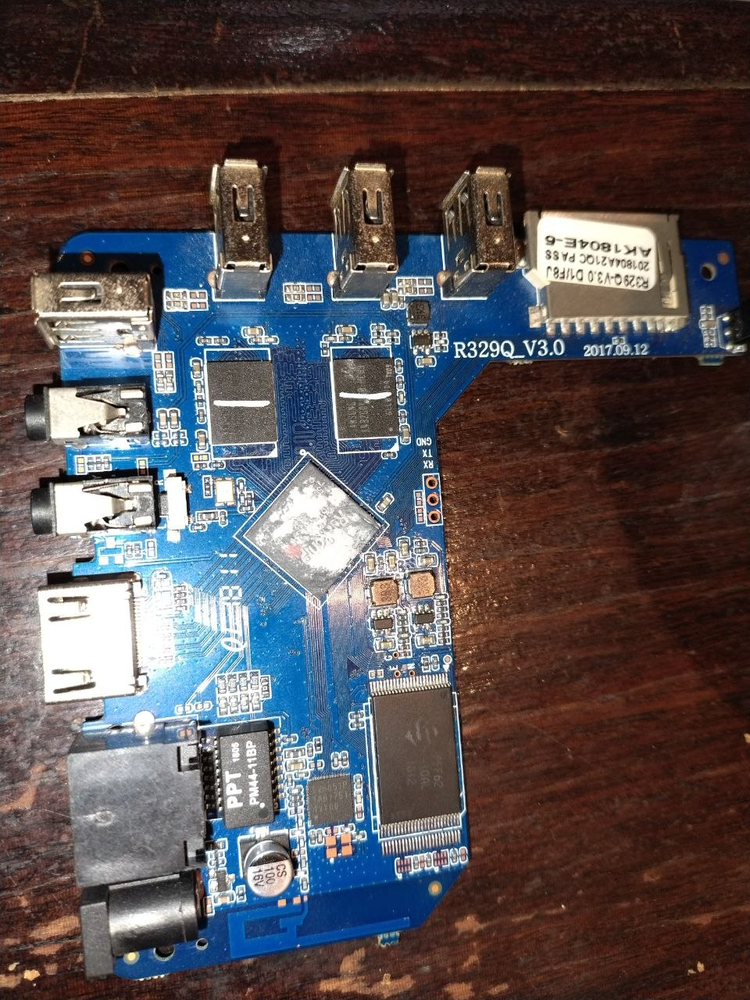
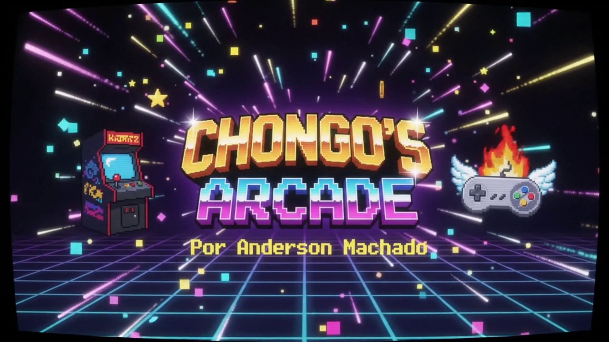
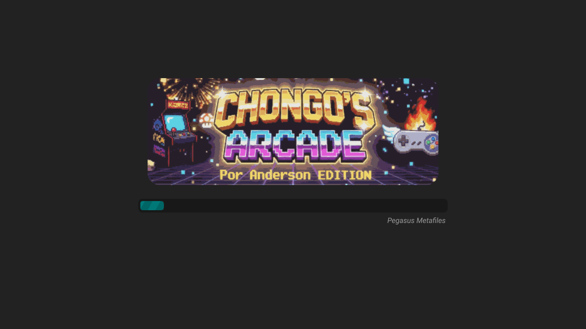
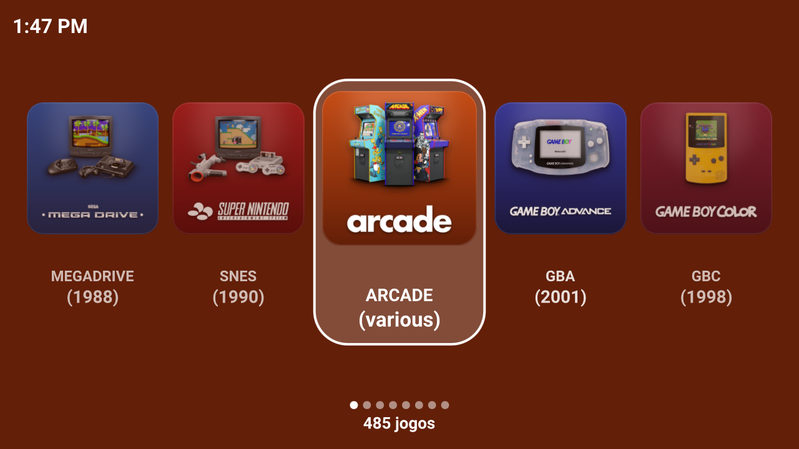
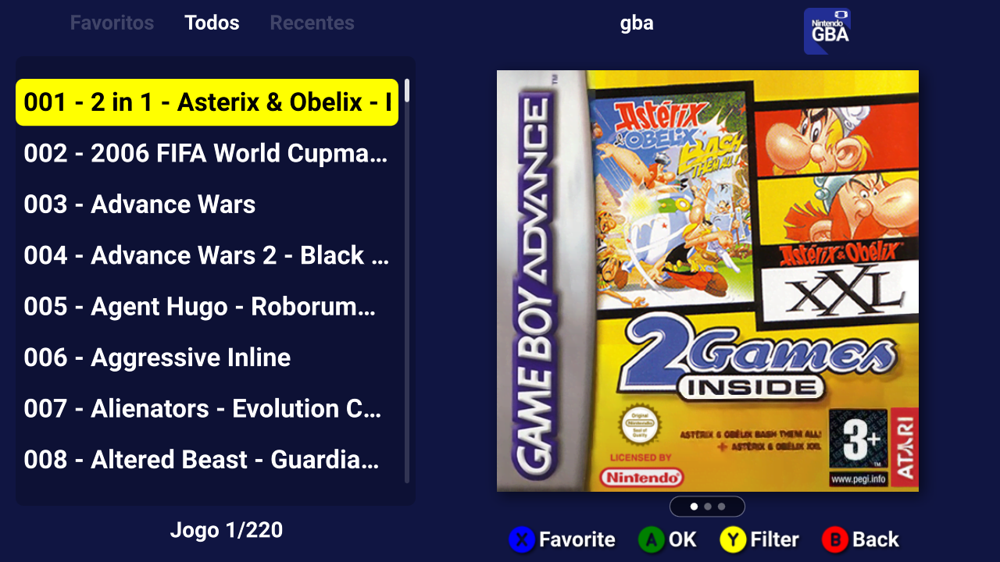

# TV Box Arcade Skill (`tvbox-arcade-builder`)

> Site oficial e vitrine interativa: **[andersonmachado.web.app](https://andersonmachado.web.app/)**

Skill aberta no padrão [Agent Skills](https://agentskills.io/) (compatível com **Antigravity**, **Gemini CLI**, **Claude Code**, **Cursor**, **Codex** e **GitHub Copilot**) para transformar TV Boxes Android de baixo custo — especialmente placas **Rockchip RK3229 / RK322x (Android 7.1, 32-bit `armeabi-v7a`, Mali-400, 1 GB RAM, Raw NAND)** — em sistemas dedicados de arcade/multijogos via ADB, sem arriscar brick na NAND interna.

## Galeria de Referência (Hardware & Sistema em Funcionamento)

| Placa-alvo (`R329Q_V3.0` · RK3229) | Tela de Inicialização (`bootanimation.ts`) |
| :---: | :---: |
|  |  |

| Tela de Carregamento do Pegasus (`logo.png`) | Sistema Pronto — Consoles (`RGLegacy`) |
| :---: | :---: |
|  |  |

**Lista de jogos com capas automáticas (`boxfront` + `screenshot`):**



## O que esta skill automatiza

- **Diagnóstico de hardware via ADB (`scripts/audit_tvbox.py`):** verifica em 1 comando read-only (uma única chamada `adb shell`) SoC, ABI, SDK do Android, RAM, espaço livre em `/system` e `/data`, armazenamento (`rknand` vs eMMC), GPU/GLES, root, temperatura, pendrives montados, controles USB conectados e viabilidade de emulação.
- **Deploy com dry-run e rollback (`scripts/deploy_tvbox.py` / `scripts/rollback_tvbox.py`):** instala APKs, cores, configs, tema, keylayouts, ajustes de quiosque do Android, debloat e launcher padrão — só altera a TV Box com `--apply` e grava um `tvbox_rollback.json` para desfazer tudo.
- **Verificação automática (`scripts/verify_tvbox.py`) e lint de temas (`scripts/lint_qml_theme.py`):** checklist final com código de saída e detecção de sintaxe ES2020+ (`??`, `?.`) que quebra temas no Qt 5.15 do Pegasus.
- **Stack Arcade otimizada (Android enxuto + RetroArch 32-bit + Pegasus Frontend):**
  - Download de binários oficiais (`RetroArch_ra32`, cores `armeabi-v7a`, `Pegasus Frontend` e tema **RGLegacy** compatível com Qt 5.15).
  - Configuração de vídeo 16:9 em tela cheia (OpenGL ES 2.0 + threaded video, sem controles touch virtuais), modo quiosque do RetroArch e presets de opções de core para Cortex-A7.
  - Desativação segura (reversível via `pm disable-user`) de apps não essenciais para uso dedicado como console.
- **Organização de ROMs em pendrive USB/SD + Capas automáticas:**
  - Geração de `metadata.pegasus.txt` (incluindo tradução de nomes de **MAME** e **FBNeo/Neo Geo** via DATs oficiais).
  - Download automatizado de `boxfront.png` e `screenshot.png` direto do repositório público `libretro-thumbnails`.
  - Geração de cards visuais `600x600` combinando fotos de hardware dos consoles com logos oficiais.
- **Música de fundo em loop contínuo:** gerador de `Music.qml` otimizado para o `RockFFPlayer` (carrega 1 faixa `.ogg`/`.mp3` por vez em fila embaralhada sem repetição + watchdog automático + pausa ao abrir jogos).
- **Controles USB e Moedeiro:** perfis `.kl` (Android KeyLayout) e `.cfg` (RetroArch) para placas **Zero Delay Arcade (`0079:0006`)** e controles **PS3/PC dual-mode (`054c:0268` / `0e8f:0003`)** com layout de 6 botões de luta, hotkeys num botão de serviço (K11) para que o pulso do moedeiro no `Select` nunca feche o jogo, e guia elétrico para moedeiro eletrônico.
- **Personalização segura de Boot e Splash:** scripts com **validação dinâmica** (sem offsets fixos) para trocar `bootanimation.ts`, `bootanimation.zip`, `logo.bmp` e `logo_kernel.bmp` (24 ou 8 bits) na partição `resource` e o `logo.png` da tela de carregamento do Pegasus (com backup obrigatório e rollback documentado).

---

## Como instalar a Skill

### Instalação universal em 1 comando (recomendado)
Compatível com **Cursor, Claude Code, Codex, Gemini CLI, GitHub Copilot, Windsurf e Antigravity**:

```bash
# No projeto atual
npx skills add Andersonkesto/tvbox-arcade-skill

# Global (todas as sessões)
npx skills add Andersonkesto/tvbox-arcade-skill -g
```

### Instalação manual via Git ou Release ZIP
Clone este repositório (ou baixe o `.zip` pronto na aba **Releases**) e copie `skills/tvbox-arcade-builder` para o diretório de skills do seu agente:

```bash
git clone https://github.com/Andersonkesto/tvbox-arcade-skill.git
```

- **Global (todas as sessões):** copie `skills/tvbox-arcade-builder/` para `~/.gemini/config/skills/tvbox-arcade-builder/` (Antigravity) ou `~/.agents/skills/tvbox-arcade-builder/` (Gemini CLI / Codex).
- **Por projeto (workspace):** copie para `.agents/skills/tvbox-arcade-builder/` na raiz do projeto.

### Dependências no PC (para os scripts auxiliares)
- **Python 3.10+** com **Pillow**: `pip install -r skills/tvbox-arcade-builder/requirements.txt`
- **ADB (`platform-tools`)** conectado à TV Box via rede ou USB
- **FFmpeg** (opcional, apenas para conversão de vídeo de boot)
- **Java JDK + `zipalign` + `apksigner` / SignApk** (opcional, apenas para alinhar e assinar o APK caso personalize o logo de carregamento do Pegasus)

---

## Segurança e Avisos Legais

- **Este repositório NÃO contém nem distribui** ROMs, BIOS, músicas, artes proprietárias, APKs de terceiros ou chaves privadas de assinatura.
- Todo binário de emulador/frontend é obtido pelo próprio usuário diretamente das fontes oficiais (Libretro Buildbot, Pegasus Frontend GitHub Releases, RGLegacy GitHub).
- **Atenção em placas com Raw NAND (`rknand`):** operações em `/system` ou na partição `rknand_resource` exigem acesso `root` e **backup prévio obrigatório** descrito na skill. Use por sua conta e risco e nunca execute `dd` em partições sem validar o tamanho e o cabeçalho da sua placa.

## Créditos e Licenças de Terceiros

Os scripts e documentos deste repositório são licenciados sob **MIT** (veja [LICENSE](./LICENSE)). Os projetos de terceiros referenciados mantêm suas próprias licenças:
- [RetroArch / Libretro](https://www.libretro.com/) — GPLv3
- [Pegasus Frontend](https://pegasus-frontend.org/) — GPLv3
- [RGLegacy Theme](https://github.com/ZagonAb/RGLegacy) — CC-BY-NC-SA 4.0
- [Libretro Thumbnails](https://github.com/libretro-thumbnails) — repositório comunitário de artes
